# Monitorización

## 1. Procesos y CPU

### 1.1. PS

**Uso:**

El comando ps permite visualizar los procesos
que se están ejecutando en el sistema Linux.

**Sintaxis:**

ps [opciones]

**Opciones principales:**

- -a: muestra procesos de diferentes usuarios.
- -u: muestra información detallada del usuario.
- -x: incluye procesos sin terminal asociada.

**Interpretación:**

Permite conocer los procesos activos, su
identificador PID, el usuario que los ejecuta
y el consumo de CPU y memoria.

**Captura:**

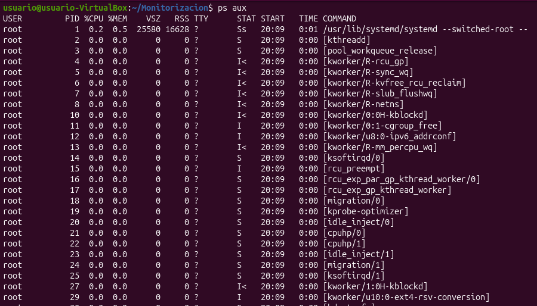

### 1.2. TOP

**Finalidad:**

El comando top permite monitorizar en tiempo real
los procesos que se están ejecutando en Linux,
mostrando el consumo de CPU y memoria RAM.

**Sintaxis:**

top [opciones]

**Opciones principales:**

- -d 2: actualiza la información cada 2 segundos.
- -u usuario: muestra los procesos de un usuario.
- -p PID: muestra un proceso específico.

**Interpretación:**

Permite observar el consumo de CPU y memoria
de los procesos activos. Es útil para detectar
procesos que consumen demasiados recursos y
posibles problemas de rendimiento.

**Captura:**

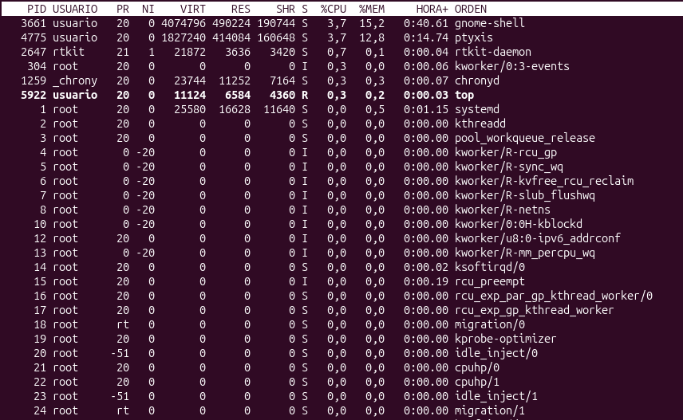

### 1.3. HTOP

**Finalidad:**

El comando htop permite monitorizar de forma
interactiva los procesos del sistema Linux.
Es una alternativa visual al comando top.

**Sintaxis:**

htop [opciones]

**Opciones principales:**

- -u usuario: muestra los procesos de un usuario.
- -p PID: muestra procesos específicos.
- -d 20: actualiza la información cada 2 segundos.

**Interpretación:**

Muestra información sobre el uso de CPU,
memoria RAM y memoria swap, además de los
procesos que se encuentran en ejecución.
Permite identificar procesos que consumen
demasiados recursos.

**Captura:**

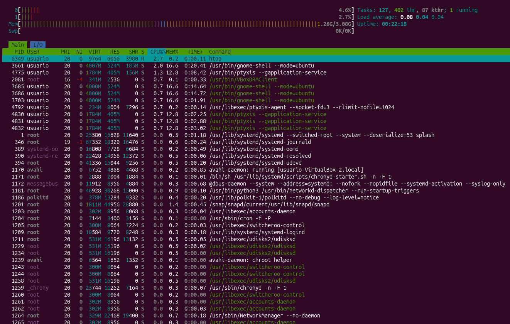

### 1.4. ATOP

**Finalidad:**

El comando atop permite monitorizar de forma
avanzada los recursos de un sistema Linux.
Muestra información sobre CPU, memoria RAM,
disco, red y procesos activos.

**Sintaxis:**

atop [opciones] [intervalo]

**Opciones principales:**

- -V: muestra la versión instalada.
- -r archivo: permite consultar registros anteriores.
- -w archivo: guarda los datos de monitorización.

**Interpretación:**

Permite analizar el consumo de CPU, memoria,
disco y red de los procesos. Es útil para detectar
problemas de rendimiento y localizar procesos
que consumen demasiados recursos.

**Captura:**

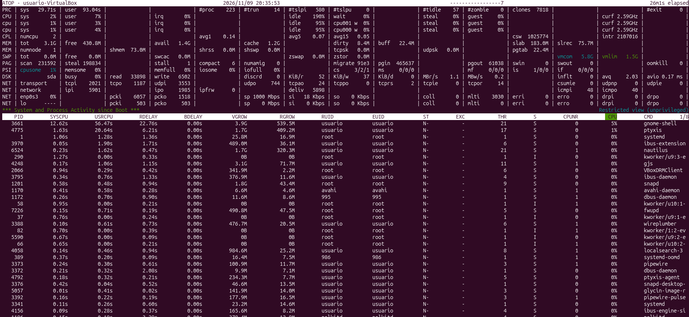

### 2.1. FREE

**Finalidad:**

El comando free permite consultar la cantidad de memoria RAM utilizada, libre y disponible en un sistema Linux. También muestra información sobre la memoria de intercambio (SWAP).

**Sintaxis:**

```bash
free [opciones]
```

**Opciones principales:**

- `-h`: muestra los valores en unidades legibles para las personas.
- `-m`: muestra los valores en megabytes.
- `-g`: muestra los valores en gigabytes.
- `-s 2`: actualiza la información cada 2 segundos.

**Interpretación:**

Permite conocer la memoria RAM total, utilizada, libre y disponible. También muestra el consumo de SWAP. Es útil para detectar problemas relacionados con la falta de memoria y controlar los recursos del servidor.

**Captura:**

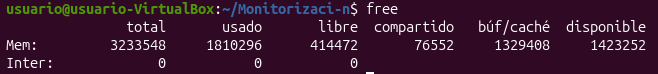

### 3.1. DF

**Finalidad:**

El comando df permite consultar el espacio de almacenamiento de los discos y sistemas de archivos de Linux. Muestra el espacio total, utilizado y disponible.

**Sintaxis:**

df [opciones] [archivo]

**Opciones principales:**

- -h: muestra los tamaños en unidades legibles para las personas.
- -T: muestra el tipo de sistema de archivos.
- -i: muestra información sobre los inodos.
- -m: muestra los tamaños en megabytes.

**Interpretación:**

Permite conocer el espacio total, utilizado y disponible de los sistemas de archivos, así como el porcentaje de almacenamiento ocupado. Es útil para detectar discos próximos a llenarse y prevenir problemas de almacenamiento.

**Captura:**

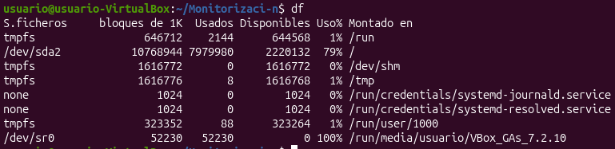

### 3.2. DU

**Finalidad:**

El comando du (Disk Usage) permite consultar cuánto espacio de almacenamiento ocupan los archivos y directorios de un sistema Linux. Es útil para identificar qué carpetas consumen más espacio.

**Sintaxis:**

```bash
du [opciones] [archivo o directorio]
```

**Opciones principales:**

- `-h`: muestra los tamaños en unidades legibles para las personas.
- `-s`: muestra solamente el tamaño total.
- `-a`: muestra el espacio ocupado por archivos y directorios.
- `--max-depth=1`: limita el resultado a un nivel de profundidad.

**Interpretación:**

Permite conocer cuánto espacio ocupan los archivos y directorios del sistema. Es útil para localizar carpetas que consumen demasiado almacenamiento y optimizar el espacio disponible en el servidor.

**Captura:**

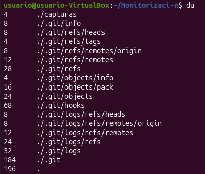

### 3.3. IOSTAT

**Finalidad:**

El comando iostat permite monitorizar el rendimiento de los dispositivos de almacenamiento de Linux. Proporciona información sobre las operaciones de lectura y escritura, la velocidad de transferencia y el tiempo de espera de los discos.

**Sintaxis:**

```bash
iostat [opciones] [intervalo] [recuento]
```

**Opciones principales:**

- `-x`: muestra estadísticas ampliadas de los dispositivos.
- `-d`: muestra estadísticas de los dispositivos de almacenamiento.
- `-c`: muestra estadísticas de utilización de CPU.
- `-h`: muestra los datos en un formato más legible.
- `-z`: omite dispositivos que no han tenido actividad.

**Interpretación:**

Permite conocer la actividad de los discos, las operaciones de lectura y escritura, los tiempos de espera y el porcentaje de utilización. Es útil para detectar posibles problemas de rendimiento y cuellos de botella en el almacenamiento.

**Captura:**

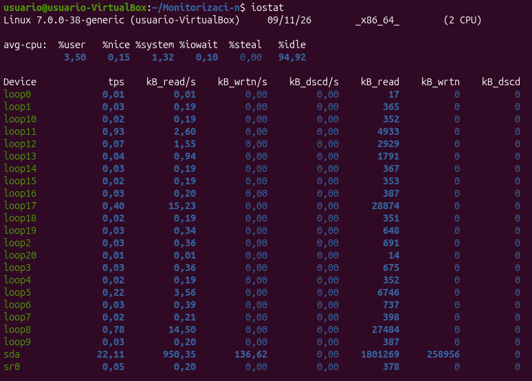

### 4.1. TCPDUMP

**Finalidad:**

El comando tcpdump permite capturar y analizar paquetes de datos que circulan por una interfaz de red en Linux. Proporciona información sobre las direcciones IP de origen y destino, los protocolos utilizados y las características de los paquetes.

**Sintaxis:**

```bash
tcpdump [opciones] [filtro]
```

**Opciones principales:**

- `-i`: selecciona la interfaz de red que se quiere monitorizar.
- `-n`: evita traducir las direcciones IP a nombres de dominio.
- `-c`: indica el número máximo de paquetes que se capturarán.
- `-w`: guarda los paquetes capturados en un archivo.
- `-r`: permite leer paquetes guardados anteriormente.
- `-v`: muestra información más detallada.

**Interpretación:**

Permite observar el tráfico de red, las direcciones IP de origen y destino y los protocolos utilizados. Es útil para analizar comunicaciones, detectar problemas de conectividad y comprobar el funcionamiento de una red.

**Captura:**

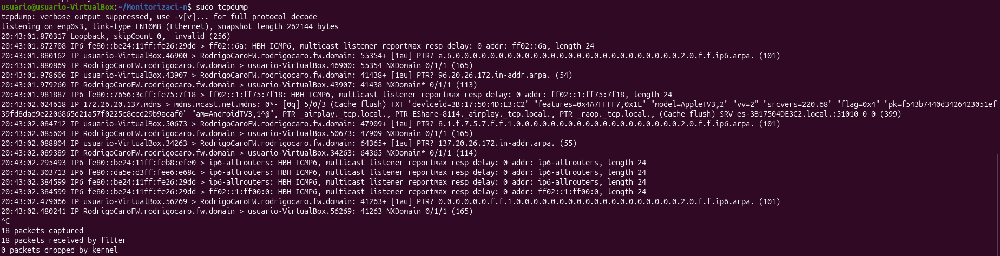

### 4.2. TCPTRACK

**Finalidad:**

El comando tcptrack permite monitorizar en tiempo real las conexiones TCP de una interfaz de red. Muestra información sobre las direcciones IP de origen y destino, los puertos, el estado de las conexiones y la velocidad de transferencia.

**Sintaxis:**

```bash
tcptrack [opciones] -i interfaz
```

**Opciones principales:**

- `-i`: selecciona la interfaz de red que se quiere monitorizar.
- `-d`: muestra únicamente las conexiones iniciadas después de ejecutar el programa.
- `-f`: activa el recálculo rápido de las velocidades medias.
- `-p`: evita activar el modo promiscuo de la interfaz.
- `-v`: muestra la versión del programa.
- `-r`: establece el tiempo que permanecen en pantalla las conexiones cerradas.

**Interpretación:**

Permite observar las conexiones TCP activas, sus direcciones IP, los puertos utilizados y la velocidad de transferencia. Es útil para analizar el tráfico de red y detectar conexiones que consumen demasiado ancho de banda.

**Captura:**

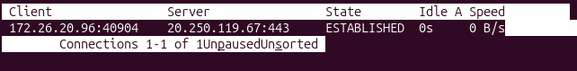

### 4.3. IPTRAF

**Finalidad:**

El comando iptraf-ng permite monitorizar el tráfico de red de un sistema Linux de forma interactiva y visual. Proporciona información sobre las direcciones IP, los protocolos TCP y UDP, los paquetes y la actividad de las interfaces de red.

**Sintaxis:**

```bash
iptraf-ng [opciones]
```

**Opciones principales:**

- `-i interfaz`: inicia el monitor de tráfico IP de una interfaz.
- `-g`: muestra estadísticas generales de las interfaces.
- `-d interfaz`: muestra estadísticas detalladas de una interfaz.
- `-s interfaz`: monitoriza el tráfico TCP y UDP.
- `-z interfaz`: muestra el número de paquetes según su tamaño.
- `-t tiempo`: establece el tiempo de ejecución en minutos.

**Interpretación:**

Permite observar el tráfico de red, las direcciones IP de origen y destino, los protocolos utilizados y la cantidad de datos transferidos. Es útil para analizar las comunicaciones y detectar posibles problemas de conectividad.

**Captura:**

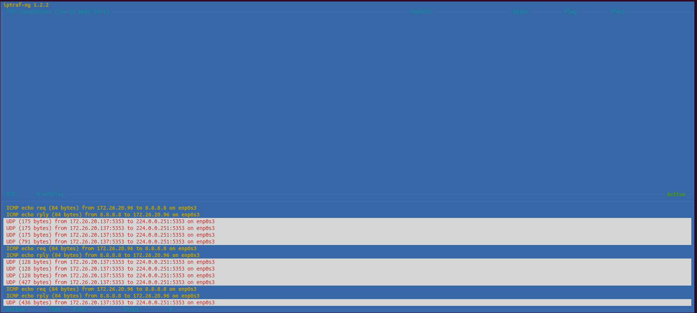

### 4.4. BMON

**Finalidad:**

El comando bmon (Bandwidth Monitor) permite monitorizar el tráfico y el ancho de banda de las interfaces de red de Linux en tiempo real. Muestra información sobre los datos recibidos y enviados, así como la velocidad de transferencia.

**Sintaxis:**

```bash
bmon [opciones]
```

**Opciones principales:**

- `-p`: selecciona las interfaces de red que se quieren monitorizar.
- `-b`: muestra las velocidades en bits por segundo.
- `-r`: establece el intervalo de lectura de estadísticas en segundos.
- `-a`: muestra todas las interfaces, incluso las que están desactivadas.
- `-o`: selecciona el tipo de salida de información.
- `-V`: muestra la versión del programa.

**Interpretación:**

Permite observar la cantidad de datos recibidos (RX) y enviados (TX), así como la velocidad de transferencia de las interfaces de red. Es útil para controlar el consumo de ancho de banda y detectar posibles problemas de rendimiento de la red.

**Captura:**

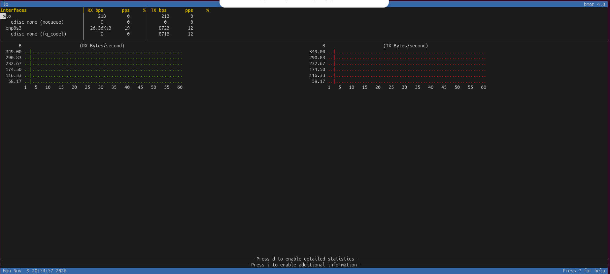

### 5.1. SS

**Finalidad:**

El comando ss (Socket Statistics) permite consultar las conexiones de red y los puertos abiertos en un sistema Linux. Proporciona información sobre conexiones TCP y UDP, direcciones IP, estados de conexión y procesos asociados.

**Sintaxis:**

```bash
ss [opciones]
```

**Opciones principales:**

- `-t`: muestra conexiones TCP.
- `-u`: muestra conexiones UDP.
- `-l`: muestra únicamente los puertos en escucha.
- `-n`: muestra direcciones y puertos numéricos.
- `-p`: muestra los procesos asociados a las conexiones.
- `-a`: muestra todas las conexiones y sockets.
- `-s`: muestra un resumen de las estadísticas de red.

**Interpretación:**

Permite conocer los puertos que están escuchando, las conexiones de red activas y los procesos asociados. Es útil para comprobar los servicios disponibles y diagnosticar problemas de conectividad.

**Captura:**

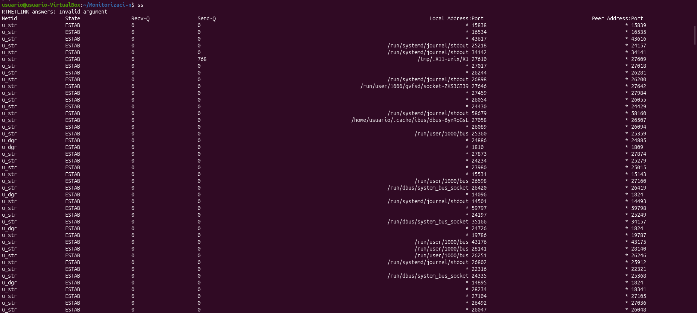

### 5.2. NMAP

**Finalidad:**

El comando nmap (Network Mapper) permite analizar una máquina o red para identificar puertos abiertos, servicios disponibles y características de los equipos. Es utilizado por los administradores para comprobar los servicios que están disponibles en sus servidores.

**Sintaxis:**

```bash
nmap [opciones] destino
```

**Opciones principales:**

- `-sT`: realiza un escaneo mediante conexiones TCP.
- `-sV`: intenta identificar los servicios y sus versiones.
- `-p`: permite seleccionar los puertos que se quieren analizar.
- `-F`: realiza un escaneo rápido de los puertos más habituales.
- `-O`: intenta identificar el sistema operativo.

**Interpretación:**

Permite conocer los puertos abiertos, cerrados o filtrados de una máquina y los servicios asociados a ellos. Es útil para comprobar qué servicios están disponibles y revisar los puertos expuestos de un servidor.

**Captura:**

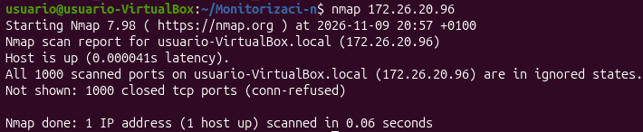

## 6. Análisis de resultados

### 1. ¿Cómo comprobarías la cantidad de memoria RAM disponible?

Utilizaría el comando `free -h`, que permite consultar la memoria RAM total, utilizada, libre y disponible del sistema.

La opción `-h` muestra los resultados en unidades fáciles de interpretar, como MB y GB.

```bash
free -h
```

Para conocer la memoria disponible para nuevas aplicaciones, observaría el valor de la columna `available`.

### 2. ¿Qué diferencia existe entre df y du?

Los comandos `df` y `du` permiten consultar información sobre el almacenamiento, pero tienen funciones diferentes.

- **df:** muestra el espacio total, utilizado y disponible de los sistemas de archivos y discos.
- **du:** muestra cuánto espacio ocupan los archivos y directorios.

Ejemplos:

```bash
df -h
du -h --max-depth=1
```

Por tanto, `df` permite conocer el espacio disponible en el disco, mientras que `du` permite identificar qué carpetas y archivos ocupan más espacio.

### 3. ¿Qué diferencias existen entre ss y nmap?

Ambos comandos permiten obtener información sobre los puertos y las conexiones de red, pero funcionan de manera diferente.

- **ss:** muestra las conexiones de red y los puertos que están escuchando en el sistema local.
- **nmap:** permite analizar una máquina o red para identificar puertos abiertos, cerrados o filtrados y los servicios disponibles.

Ejemplos:

```bash
ss -tuln
nmap 127.0.0.1
```

La principal diferencia es que `ss` consulta los sockets y conexiones del sistema, mientras que `nmap` analiza los puertos de un equipo mediante comunicaciones de red.

### 4. ¿Cómo comprobarías si un servidor tiene abierto el puerto 80?

Utilizaría el comando `ss` para comprobar si existe algún servicio escuchando en el puerto 80.

```bash
sudo ss -ltnp 'sport = :80'
```

Si aparece una línea con el puerto 80 en estado `LISTEN`, significa que existe un servicio escuchando en ese puerto.

También podría utilizar NMAP contra un servidor propio o autorizado:

```bash
nmap -p 80 127.0.0.1
```

### 5. ¿Qué herramienta utilizarías para detectar un posible cuello de botella en el disco?

Utilizaría el comando `iostat`, que permite analizar el rendimiento de los dispositivos de almacenamiento.

Ejecutaría:

```bash
iostat -xz 2 3
```

Este comando muestra estadísticas ampliadas sobre las operaciones de lectura y escritura, el tiempo de espera y el porcentaje de utilización de los discos.

Con estos datos se pueden identificar posibles problemas de rendimiento o cuellos de botella en el almacenamiento.

### 6. ¿Por qué es importante monitorizar los recursos de un servidor?

La monitorización de los recursos de un servidor es importante porque permite conocer su estado y funcionamiento en todo momento.

Ayuda a controlar el consumo de CPU, memoria RAM, almacenamiento y tráfico de red.

Además, permite detectar posibles problemas de rendimiento, identificar procesos que consumen demasiados recursos, prevenir fallos y mantener la disponibilidad de los servicios.

Por tanto, la monitorización es fundamental para garantizar el correcto funcionamiento, rendimiento y estabilidad de un servidor.
